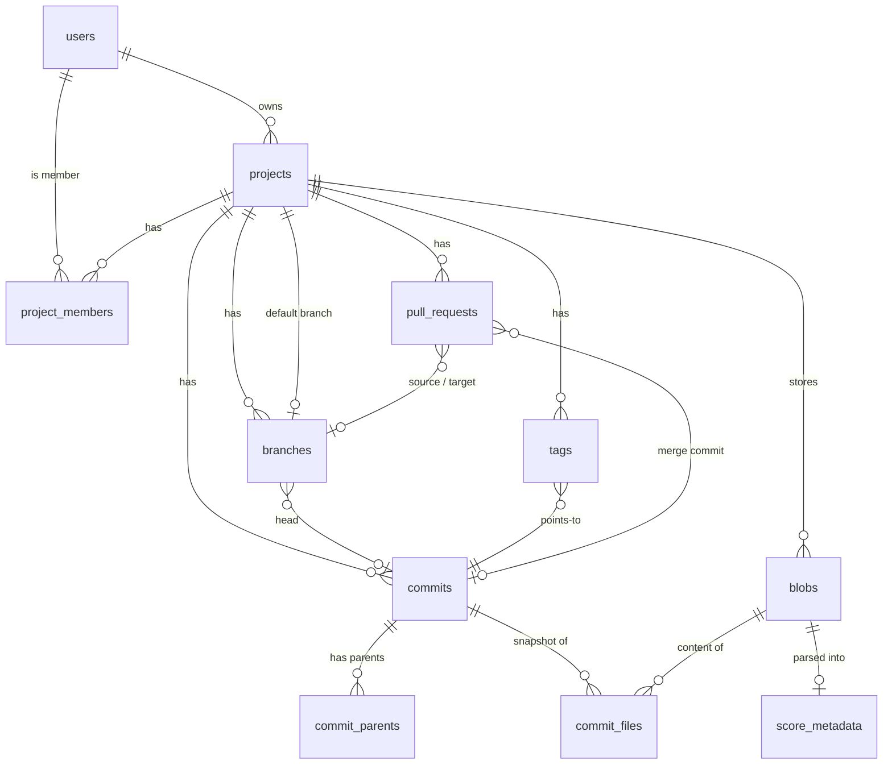

# Database schema (draft)

Draft for the 10/22 meeting (issue #12). The schema itself is [`prisma/schema.prisma`](../prisma/schema.prisma). No migration has been generated yet; we create one once the team agrees on the design.

This document has three parts:

1. **[How version control works here](#part-1-how-version-control-works-here)**: the concepts, built up one at a time with a worked example.
2. **[Reading the schema and PostgreSQL](#part-2-reading-the-schema-and-postgresql)**: where the definition lives in the code, how Prisma maps to SQL, and how to look at the real database.
3. **[Reference](#part-3-reference)**: every table, the design decisions, and the meeting agenda.

---

## Part 1: How version control works here

ScoreControl copies git's design, which comes down to two ideas:

- **Content never changes.** Once a version of a file is saved, it is never edited or overwritten. New versions are new rows.
- **Names point at content.** "main", "v1.0", and "the latest version" are just labels pointing at saved versions. Moving a label is cheap; the history underneath stays put.

Everything below follows from those two ideas.

### Blobs: one version of one file's contents

A **blob** is the raw bytes of a file at one moment, for example the contents of `score.musicxml` after Tuesday's edit. A blob has no name and no path. It is just content.

We identify each blob by its **SHA-256 hash**, a 64-character fingerprint computed from the bytes:

- The same bytes always produce the same hash.
- Changing a single note produces a completely different hash.
- Two different files practically never share a hash.

That gives us three things for free:

1. **Deduplication.** Re-uploading an unchanged file produces the same hash, so we notice it already exists and store nothing new.
2. **Integrity.** We can re-hash a downloaded file to prove it wasn't corrupted.
3. **Safe sharing.** Because a blob never changes, a hundred commits can point at the same blob without risk.

The bytes themselves live in **Supabase Storage** (file storage, like S3), at `{projectId}/{sha256}`. The `blobs` table holds only metadata: hash, size, format, and content type. Score files can be several megabytes, and keeping them out of Postgres keeps the database small and fast.

### Snapshots: the full file list of a commit

A **snapshot** answers the question "what did the whole project look like at this moment?" It is a list of `path → blob` pairs, stored in `commit_files`:

| commit | path | blob |
|---|---|---|
| C3 | `score.musicxml` | B2 |
| C3 | `parts/viola.musicxml` | B3 |

Every commit lists **all** of its files, not only the ones that changed. That sounds wasteful, but it isn't: an unchanged file is one tiny row pointing at a blob that already exists. Nothing is copied.

The alternative is storing only the changes ("deltas"), which has two problems. Reading version 50 means replaying 50 sets of changes, and the stored format would be tied to whatever diff algorithm we use. With snapshots, reading any version is a single query, and **"what changed?" is just comparing two lists**: paths that appear in only one list were added or deleted, and paths whose blob differs were modified.

### Commits: a saved point in history

A **commit** is one row in `commits` with a message ("Fix bowing in m. 12"), an author, and a timestamp. Its snapshot is its rows in `commit_files`. Commits are immutable: once saved, nothing about them changes.

### Parent links: how commits form a history

Each commit records which commit(s) it came after. These links live in `commit_parents`:

- **0 parents:** the first commit in a project.
- **1 parent:** a normal commit. Its parent is the version it was edited from.
- **2 parents:** a **merge commit**, which joins two lines of work. `position = 0` is the branch merged into (for example main), and `position = 1` is the branch merged in.

Following parent links backwards from any commit gives its full history, the same as `git log`. Two commits share history at the point where their parent chains meet, and that meeting point (the **merge base**) is what the merge engine needs.

The links live in their own table, not in a column on `commits`, because a merge has two parents and a foreign key column can only hold one. A separate table also lets the database enforce that every parent really exists.

### Branches: movable labels

A **branch** is a name plus a pointer to its newest commit (`head_commit_id`). It holds nothing else: no files, no copy of history.

- **Creating a branch** inserts one row pointing at an existing commit. It costs nothing and copies nothing.
- **Committing to a branch** creates the new commit and moves the branch's pointer to it.
- **Deleting a branch** deletes only the label. Any commit still reachable through parent links from another branch, such as a merge commit on main, stays in the history.

**Two people committing at the same moment.** Both users start from main at C2. Each saves a new commit, then moves main with:

```sql
UPDATE branches SET head_commit_id = :new
WHERE id = :main AND head_commit_id = :c2   -- "only if main is still where I started"
```

The first update matches one row and wins. The second matches zero rows because main has already moved, so its transaction rolls back and that user sees "main changed — update and try again". Nobody's work is silently overwritten. This pattern is called **compare-and-swap**.

### Merges and pull requests

A **pull request** (PR) is a proposal: "merge branch `viola-edits` into `main`". It's a row in `pull_requests` with a title, a description, the two branches, and a status: `OPEN`, `MERGED`, or `CLOSED`.

Merging takes three versions of each file. The **base** comes from the merge base (the common ancestor). **Ours** is the target branch's version, and **theirs** is the source branch's. If only one side changed a file, take that side. If both sides changed it, the **merge engine** (not our responsibility) combines them or reports a conflict. The backend saves the result as a new commit with two parents, moves the target branch, and marks the PR `MERGED` with `merge_commit_id`.

**Tags** are like branches that never move: a fixed name for an important commit, such as `premiere-2026-11-14`.

### Worked example: a string quartet

**1. The composer uploads `score.musicxml`.** Its bytes hash to blob **B1**. Commit **C1** ("Initial score") has no parents. Branch `main` → C1.

**2. The composer fixes bowing.** The new bytes become blob **B2**. Commit **C2** has parent C1, and its snapshot is `score.musicxml → B2`. `main` → C2.

**3. A violist branches off and adds a part.** Branch `viola-edits` → C2 (a single new row). They upload `parts/viola.musicxml` (blob **B3**). Commit **C3** has parent C2, and its snapshot is `score.musicxml → B2` (unchanged, so the same blob is reused) plus `parts/viola.musicxml → B3`. `viola-edits` → C3.

**4. Meanwhile, the composer edits the title page on main.** Blob **B4**, commit **C4** with parent C2. `main` → C4.

**5. The violist opens PR #1: `viola-edits` → `main`. It gets merged.** The merge base is C2, where both histories meet.
- `score.musicxml`: base B2, main B4, viola-edits B2. Only main changed it, so the result is B4.
- `parts/viola.musicxml`: exists only on viola-edits, so the result is B3.

The backend creates merge commit **C5** with parents C4 (position 0) and C3 (position 1). Its snapshot is `score.musicxml → B4` and `parts/viola.musicxml → B3`. `main` → C5, and PR #1 is `MERGED` with merge commit C5.

**6. `viola-edits` is deleted.** C3 is still reachable from C5 through its second parent link, so nothing is lost.

```
main:         C1 ── C2 ────────── C4 ── C5
                      \                 /
viola-edits:           └───── C3 ──────┘
```

The rows at the end:

| Table | Rows |
|---|---|
| `blobs` | B1, B2, B3, B4 (four versions of content; nothing is stored twice) |
| `commits` | C1 … C5 |
| `commit_parents` | C2→C1, C3→C2, C4→C2, C5→C4 (pos 0), C5→C3 (pos 1) |
| `commit_files` | C1: 1 row · C2: 1 · C3: 2 · C4: 1 · C5: 2 |
| `branches` | main → C5 |
| `pull_requests` | #1 MERGED, merge commit C5, source branch null (deleted) |

### Who can do what

The project owner (`projects.owner_id`) can do everything. Other people are added in `project_members` with a role:

| Role | Can |
|---|---|
| `VIEWER` | Read a private project |
| `EDITOR` | Also create branches, commit, open and merge PRs |
| `ADMIN` | Also manage members and settings, delete branches |

### Musical metadata

When a MusicXML or MuseScore blob is uploaded, a parser can read the title, composer, arranger, lyricist, opening key, meter, tempo, measure count, and the list of parts (instruments) into `score_metadata`, keyed by blob. Because blobs never change, this metadata is versioned automatically: comparing C1's and C5's metadata answers "when did we add the viola?"

---

## Part 2: Reading the schema and PostgreSQL

### Where the definition lives

| Location | What it is | Edited by |
|---|---|---|
| [`prisma/schema.prisma`](../prisma/schema.prisma) | **Source of truth** for the app's tables (everything in this doc) | Us, by hand |
| `prisma/migrations/<timestamp>_<name>/migration.sql` | The SQL that creates or changes tables, one folder per change. Not created yet. | Generated by `npx prisma migrate dev`, then committed |
| [`supabase/migrations/`](../supabase/migrations/) | SQL that touches Supabase's `auth` schema: the username registry, triggers, Row Level Security (RLS). Prisma can't manage these. | Us, by hand |
| `src/generated/prisma/` | TypeScript client generated from the schema (`prisma.commit.findMany(...)`). Gitignored. | `npm install` / `npx prisma generate` |

To see the exact SQL the current schema produces, without touching any database:

```bash
npx prisma migrate diff --from-empty --to-schema prisma/schema.prisma --script
```

### Reading a Prisma model

Here's the `Commit` model and the SQL Prisma generates from it:

```prisma
model Commit {
  id        String   @id @default(dbgenerated("gen_random_uuid()")) @db.Uuid
  projectId String   @map("project_id") @db.Uuid
  authorId  String?  @map("author_id") @db.Uuid
  message   String
  createdAt DateTime @default(now()) @map("created_at") @db.Timestamptz(3)

  project Project  @relation(fields: [projectId], references: [id], onDelete: Cascade)
  author  User?    @relation(fields: [authorId], references: [id], onDelete: SetNull)
  files   CommitFile[]

  @@index([projectId, createdAt])
  @@map("commits")
}
```

```sql
CREATE TABLE "commits" (
    "id" UUID NOT NULL DEFAULT gen_random_uuid(),
    "project_id" UUID NOT NULL,
    "author_id" UUID,
    "message" TEXT NOT NULL,
    "created_at" TIMESTAMPTZ(3) NOT NULL DEFAULT CURRENT_TIMESTAMP,
    CONSTRAINT "commits_pkey" PRIMARY KEY ("id")
);
CREATE INDEX "commits_project_id_created_at_idx" ON "commits"("project_id", "created_at");
ALTER TABLE "commits" ADD CONSTRAINT "commits_project_id_fkey"
  FOREIGN KEY ("project_id") REFERENCES "projects"("id") ON DELETE CASCADE;
ALTER TABLE "commits" ADD CONSTRAINT "commits_author_id_fkey"
  FOREIGN KEY ("author_id") REFERENCES "users"("id") ON DELETE SET NULL;
```

How the pieces line up:

| Prisma | PostgreSQL | Meaning |
|---|---|---|
| `model Commit` + `@@map("commits")` | `CREATE TABLE "commits"` | A table. Prisma names are PascalCase/camelCase; database names are snake_case. |
| `projectId ... @map("project_id")` | column `project_id` | A column. `@map` sets the database name. |
| `String @db.Uuid`, `String`, `DateTime @db.Timestamptz(3)`, `BigInt`, `Json` | `UUID`, `TEXT`, `TIMESTAMPTZ(3)`, `BIGINT`, `JSONB` | Column types. `timestamptz` stores an exact moment in time, with time zone, to the millisecond. |
| `String?` (question mark) | no `NOT NULL` | The column may be empty (null). |
| `@id` | `PRIMARY KEY` | The unique identifier of each row. |
| `@default(...)` | `DEFAULT ...` | The value used when an insert doesn't provide one. |
| `@relation(fields: [projectId], references: [id])` | `FOREIGN KEY ... REFERENCES` | `project_id` must match a real `projects.id`. The database refuses rows that point at nothing. |
| `onDelete: Cascade` / `SetNull` / `NoAction` | `ON DELETE CASCADE` / `SET NULL` / `NO ACTION` | What happens to this row when the row it points at is deleted: delete this row too, empty the column, or refuse the delete. |
| `files CommitFile[]` | *(nothing)* | Not a column. It is the other side of `commit_files.commit_id`, so code can write `commit.files`. |
| `@@unique([projectId, name])` | `UNIQUE INDEX` | No two rows may share that combination, e.g. two branches named `main` in one project. |
| `@@index([projectId, createdAt])` | `INDEX` | A lookup structure that makes "commits in this project, newest first" fast. |
| `enum FileFormat { ... }` | `CREATE TYPE "file_format" AS ENUM (...)` | A column that only accepts the listed values. |
| `/// comment` | *(none)* | Documentation that appears in editor tooltips for the generated client. |

A few more database terms:

- **Transaction:** a group of statements that succeed or fail together. A commit inserts into four tables in one transaction, so a crash halfway through never leaves half a commit behind.
- **Composite primary key** (`@@id([commitId, path])`): the row is identified by the pair. One commit can't list the same path twice.
- **Recursive query** (`WITH RECURSIVE`): SQL's way of following links repeatedly, which is how we walk parent links for history.

### Looking at the real database

The tables appear only after the migration is applied (see the follow-ups). Then:

- **Supabase dashboard → Table Editor:** browse rows like a spreadsheet. **Database → Schema Visualizer:** an auto-drawn diagram of tables and links. **SQL Editor:** run queries.
- **`npx prisma studio`:** a local browser UI over the same tables (it reads `.env.local`).
- **`psql "$DIRECT_URL"`:** the Postgres command line. `\dt` lists tables, `\d commits` describes one table, and `\q` quits.

Example queries:

```sql
-- Files in a commit
SELECT path, blob_id FROM commit_files WHERE commit_id = '<commit id>';

-- History of main: walk first parents back from the branch head
WITH RECURSIVE history(id, depth) AS (
  SELECT head_commit_id, 0 FROM branches WHERE project_id = '<project id>' AND name = 'main'
  UNION ALL
  SELECT p.parent_id, h.depth + 1
  FROM history h JOIN commit_parents p ON p.commit_id = h.id AND p.position = 0
)
SELECT c.message, c.created_at FROM history h JOIN commits c ON c.id = h.id ORDER BY h.depth;
```

---

## Part 3: Reference

### Diagram



Notation: `||` means exactly one, `o|` zero or one, and `o{` zero or more. For example, `projects ||--o{ commits` reads "one project has zero or more commits".

### Tables

| Table | What it is | Mutable? |
|---|---|---|
| `users` | Public user record (profile). `id` = Supabase `auth.users.id`. | Yes |
| `projects` | A repository: a piece, arrangement, or collection. URL is `/{username}/{slug}`. | Yes |
| `project_members` | Collaborators with a role. The owner is `projects.owner_id`, not a member row. | Yes |
| `blobs` | File content metadata: hash, size (max 25 MB), format (default MusicXML), `storage_path` in the private Storage bucket, and `parsed_ast`, a cached parsed score for the diff engine. Unique per project by hash. | No |
| `score_metadata` | Musical info parsed from a blob. Optional and filled by the parser. | No (re-parse replaces) |
| `commits` | Saved point in history: message (AI-suggested or user-edited, always set), optional `ai_summary`, author, time. | No |
| `commit_parents` | History links. 0 parents = first commit, 1 = normal, 2 = merge. | No |
| `commit_files` | A commit's full snapshot: `(commit, path) → blob`. | No |
| `branches` | Name → head commit. Unique name per project. | Yes |
| `tags` | Name → fixed commit. | Rarely |
| `pull_requests` | Proposal to merge one branch into another, numbered per project. `ai_conflict_notes` caches LLM conflict explanations. | Yes |

Supported file formats (`FileFormat`): `MUSICXML`, `MXL` (compressed MusicXML), `MSCZ` (compressed MuseScore), `MSCX` (uncompressed MuseScore), and `OTHER` (PDFs, audio). Every format is versioned the same way; only parsing and rendering depend on the format.

### Design decisions

- **Snapshots, not deltas:** see Part 1. A project holds tens of files at most, so a full file list per commit is cheap, and we don't need git's nested tree objects.
- **The diff/merge engine sits behind a clean boundary.** The engine takes blobs and returns new file content. Nothing in the schema depends on the algorithm. Cached diffs or comments pinned to a measure can be added later as new tables.
- **Blobs are scoped to one project**, not deduplicated across projects. That way a hash can't reveal whether a private project contains a file, and deleting a project deletes its storage folder.
- **Musical metadata attaches to blobs, not projects**, because it lives inside the file and changes from version to version.
- **Compare-and-swap on branch heads** prevents lost updates without locks (see Part 1).
- **Deletion rules:**
  - Deleting a project deletes everything inside it.
  - Deleting an account deletes the user's own projects. Commits and PRs they made in other projects stay, with the author set to null ("deleted user").
  - You can't delete a project's default branch. Deleting another branch keeps its PRs and only clears the branch reference.
  - Commits and blobs are never deleted on their own, only with their project, so references to them cascade or set null. (Postgres runs `NO ACTION` checks partway through a cascade, so protecting them that way would make project deletion fail depending on the order Postgres deletes rows.)
- **Usernames:** the auth branch keeps login handles in a private `scorecontrol_auth.usernames` table that only the server can read. `users.username` copies the handle for joins and URLs, and a Supabase trigger keeps the two in sync (follow-up 2).
- **Conventions:** UUID primary keys generated by Postgres (`gen_random_uuid()`), `timestamptz` everywhere, snake_case in the database, and database defaults for ids and `updated_at` so plain SQL inserts (triggers, seeds) work too.

### Core operations

- **Upload / commit:** hash each file, upload new bytes to Storage, insert any new `blobs`, insert the `commits` row, its `commit_parents` row, and every `commit_files` row, then compare-and-swap the branch head. All in one transaction.
- **Create branch:** insert one `branches` row pointing at an existing commit.
- **Merge / PR merge:** find the merge base, let the engine produce the merged files, insert a commit with two parents, move the target branch, and mark the PR `MERGED`.
- **History:** walk first parents from the branch head (query in Part 2).
- **File at a version:** `commit_files` by `(commit_id, path)` → blob → Storage.

### Not in v1 (can be added later without changing the history model)

PR reviews and comments, measure-anchored comments, forks, organizations, pending invitations, protected branches, archived branches, cached diffs, and LLM-generated summaries. Each one is a new table or column.

### Open questions for the meeting

1. **MusicXML vs MuseScore as the main format?** The schema supports both. The answer matters for the parser and the diff engine, not for these tables.
2. **PR reviews in v1?** Only basic PRs are modeled. Do we need approve/request-changes and comment threads for the first demo?
3. **LLM features:** what do we generate, and is it stored? For example, commit message suggestions or "what changed" summaries. Stored output would be a column on `commits` or a small table keyed by commit.
4. **Who owns `users` creation?** Proposal: Oliver's auth migration gets a trigger that inserts the profile when a username is registered. Oliver, does that fit the auth design?
5. **Size limits:** max file size and max files per project (needed for upload validation and storage quotas).
6. **Branch archiving in the app?** Musicians may want to shelve an alternate arrangement without deleting it. That's one nullable `archived_at` column on `branches`, hidden from the default branch list. Branch names can already contain slashes (`arrangements/brass`) so the UI can group them like folders.

### Follow-ups once agreed

1. `npx prisma migrate dev --name init_schema` to create the tables.
2. A Supabase migration that adds the `users.id → auth.users(id) ON DELETE CASCADE` foreign key, the profile/username trigger, and `ENABLE ROW LEVEL SECURITY` on every new table (no policies; the server uses Prisma).
3. A private Supabase Storage bucket for blobs.
4. A shared Prisma client module (`src/lib/db.ts`) using `@prisma/adapter-pg`.
